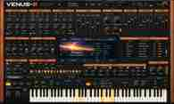

# VENUS-8 — Virtual Analog Synthesizer

## Download

**[Releases e instaladores do Venus-8](https://github.com/alexpmr/venus-8/releases)**

## Projeto

Sintetizador virtual analógico para Windows 10/11, com interface vintage, teclado virtual, entrada MIDI USB, controles em tempo real e desenvolvimento progressivo de síntese, efeitos, bancos de timbres, suporte touch e plugin VST3.

**[Roadmap de desenvolvimento](ROADMAP.md)**
