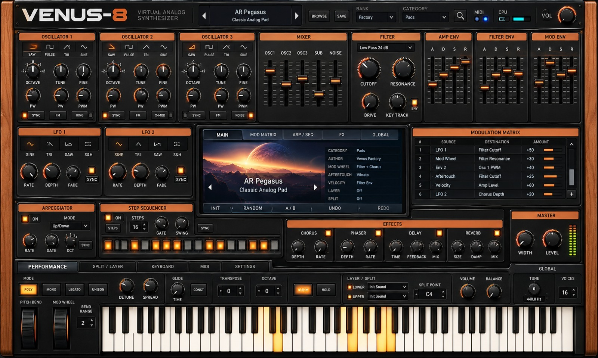

# VENUS-8 — Roadmap de desenvolvimento

**Escopo de plataformas (até nova orientação): somente Windows 10/11 x64, instalador e portátil em `.exe`. Nenhum build macOS/Linux.**

Este arquivo é o **checklist oficial por etapa**. Cada recurso só deve receber `[x]` quando existir no código e passar na validação apropriada. As marcações verdes representam recursos implementados no código; testes de hardware e homologação são etapas independentes.

**Legenda:** `✅` = implementado em nível especificado; `[ ]` = pendente, incompleto ou sem validação suficiente. Não marcar apenas por existir no mockup.

## Diretriz visual — interface hiper-realista

- [ ] Criar sistema de interface **hiper-realista** com elementos nativos e camadas gráficas em alta resolução, sem ampliação de miniaturas.
- [ ] Manter a estética do mockup oficial como referência; permitir novo layout apenas quando um recurso realmente exigir evolução do painel.
- [ ] Renderizar knobs, sliders, botões, chaves, LEDs e teclado como componentes interativos independentes, com movimento e estado visível em tempo real.
- [ ] Suportar diferentes resoluções, dimensionamento Windows e futura operação touchscreen sem perda de nitidez.
- [ ] Preservar compatibilidade de parâmetros, patches, mapeamentos MIDI, configuração e atualização ao evoluir o layout.
- [ ] Elaborar e validar uma prévia visual da nova interface antes de substituir a anterior.
- [ ] Usar ícone próprio de um sintetizador compacto com teclas e knobs no executável, janela, barra de tarefas e atalhos.

**Princípio:** o mockup é uma referência estética; imagens de painel não substituem controles reais. Layout novo é permitido quando tecnicamente justificado e mantém a identidade Venus-8.

## v0.1 — Fundação, interface e Windows

- ✅ Código inicial do aplicativo Windows em Python/Tkinter
- ✅ Interface vintage inicial, redimensionável
- ✅ Teclado virtual com clique do mouse
- ✅ Quatro formas de onda e geração básica de áudio estéreo
- ✅ Polifonia inicial com limite de 16 vozes
- ✅ Seleção básica da saída de áudio
- ✅ Detecção e seleção de entrada MIDI
- ✅ Indicadores superiores de CPU, RAM e vozes
- ✅ Controle Master Volume e botão Panic
- ✅ Salvamento e carregamento simples de patches JSON
- ✅ Arquivos de workflow Windows, PyInstaller e script Inno Setup
- ✅ Compilação do executável Windows 10/11 x64 confirmada para v0.1.0
- ✅ Publicação de instalador Setup e portátil na Release v0.1.0
- [ ] Teste real da instalação, inicialização, áudio e MIDI em Windows 10/11
- [ ] Interface final em tela cheia conforme mockup aprovado
- [ ] Knobs, sliders, switches e display animados/operacionais
- [ ] Áudio configurável: WASAPI/ASIO, sample rate, buffer e latência
- [ ] Motor centralizado de parâmetros com sincronização mouse/MIDI/patch
- [ ] Isolamento robusto do processamento de áudio em tempo real
- [ ] Monitor DSP, latência, underruns, pico e atividade MIDI
- [ ] Logs, diagnóstico e mensagens de falha compreensíveis

## v0.2.19 — Síntese FM e MIDI Learn

- ✅ Síntese FM (modulação de fase, estilo DX) entre os 3 osciladores: OSC3 → OSC2 → OSC1, com o botão FM de cada oscilador; no OSC3 o FM é realimentação (feedback).
- ✅ Knob FM (quantidade) em cada oscilador, no lugar do segundo knob PW repetido.
- ✅ Oscilador com nível 0 continua modulando (operador puro, como no DX7); razões pelos knobs OCTAVE, TUNE e FINE.
- ✅ MOD ENV ativo (A, D, S, R): controla o brilho (índice FM) ao longo da nota; a velocity também abre o brilho.
- ✅ Nova categoria FM com 8 timbres: FM E.Piano, FM Bells, FM Bass, FM Brass, FM Marimba, FM Glass Pad, FM Feedback Lead e FM Clav (64 timbres).
- ✅ **MIDI Learn**: botão direito em qualquer knob, fader, drawbar ou botão → "MIDI Learn" → mova um controle do teclado. O display mostra "MIDI LEARN" e depois "CC n → parâmetro".
- ✅ Mapeamentos salvos em settings.json; "Esquecer MIDI" no menu do controle e "Restaurar MIDI padrão" em SETTINGS. Botões do teclado alternam liga/desliga a cada toque (momentâneo ou travado).
- ✅ Testes de FM (bandas laterais, operador silencioso, feedback, MOD ENV, velocity) e de MIDI Learn.
- [ ] Homologar no Windows real.

## v0.2.18 — Órgão completo

- ✅ Percussão estilo B-3: 2ª ou 3ª harmônica, decaimento rápido ou lento, disparo único (notas em legato não redisparam) e drawbar 1' cancelado com a percussão ligada.
- ✅ Key click: estalo dos contatos no início de cada nota.
- ✅ Vibrato/Chorus de scanner (~6,9 Hz) só no órgão.
- ✅ Overdrive valvulado no órgão (knob DRIVE), assimétrico, com nível compensado.
- ✅ Leslie de dois rotores (corneta e tambor) com Doppler, giro de volume e estéreo real; lento/rápido com inércia (a corneta acelera em ~1 s, o tambor em ~4 s).
- ✅ Painel ORGAN ao lado dos drawbars: 8 botões iluminados (PERC, 3RD, P.FAST, CLICK, VIB, CHORUS, LESLIE, FAST) e knob DRIVE.
- ✅ Timbres de órgão refeitos com os novos recursos e 3 novos: Gospel Shout, Perc Groove e Leslie Swell (56 timbres).
- ✅ Testes de percussão, disparo único, click, vibrato/chorus, overdrive, Leslie (estéreo e inércia), independência do tamanho de bloco e do painel.
- [ ] Homologar no Windows real.

## v0.2.17 — Drawbars audíveis e piano elétrico real

- ✅ Órgão (drawbars) e piano elétrico mixados depois do filtro, como nos instrumentos reais: os drawbars passam a mudar claramente o som em qualquer timbre.
- ✅ Novo motor de piano elétrico (tine): brilho que decai, sino de ataque, decaimento natural por altura, bark por velocity e abafador.
- ✅ Timbres E.Piano refeitos: Suitcase Tine, Mellow Stage, Funky Bark, Tremolo Ballad e Reed Piano.
- ✅ Testes de afinação, decaimento, velocity, abafador e de órgão/piano independentes do filtro.
- [x] Homologado pelo usuário no Windows real: drawbars audíveis.
- [ ] Homologar no Windows real: piano elétrico.

## v0.2.16 — Performance, biblioteca e LCD

- ✅ Botão UPD: verde quando atualizado, laranja piscando com versão nova, um clique inicia a atualização com progresso no botão, erros sem caixas de mensagem.
- ✅ LFO 2 como vibrato (Rate e Depth ativos) e Mod Wheel controlando o vibrato.
- ✅ Pedal de sustain (MIDI CC64).
- ✅ MIDI Program Change seleciona timbres, com a confirmação no display se houver alterações.
- ✅ Biblioteca Factory: 52 timbres em 12 categorias (novas: Strings, Pluck, Bells, Organ, E.Piano, Ambient).
- ✅ Display estilo LCD com matriz de pixels e modos Colorido, Âmbar, Verde e Azul (SETTINGS).
- ✅ **Drawbars de órgão** no lugar da Modulation Matrix pintada: 9 drawbars reais (16' a 1'), 0–8 em passos, com som de tonewheels e foldback; 7 timbres de órgão com registrações clássicas. A Mod Matrix futura irá para a aba MOD MATRIX do display.
- ✅ Blocos EFFECTS e MASTER alinhados na mesma altura.
- ✅ Testes de sustain, vibrato, Mod Wheel, Program Change, estados do UPD, LCD e de todos os timbres.
- [ ] Homologar no Windows real.

## v0.2.15 — Barra superior legível

- ✅ CPU e RAM em coluna alinhada (rótulo à esquerda, valor à direita), versão acima do botão UPD.
- ✅ Textos dessa área acompanham a escala do painel, sem se sobrepor em janelas menores.
- [ ] Homologar no Windows real.

## v0.2.14 — Mais controles reais e painel sinalizado

- ✅ Knobs OCTAVE (−2 a +2, 5 posições) e FINE (±50 cents) dos 3 osciladores com som real.
- ✅ Knob VOL do topo controla o volume geral (o mesmo parâmetro do LEVEL).
- ✅ Botões de forma de onda acendem conforme a onda selecionada (antes o SAW aparecia sempre aceso, pintado na arte).
- ✅ Medidor de nível do Master em tempo real (−48 dB a 0 dB, 12 LEDs).
- ✅ Barra superior: CPU, RAM, versão atual e UPD.
- ✅ Apagados até serem implementados: Sync/FM/Ring, ondas e Sync dos LFOs, Arpeggiator, Step Sequencer, LEDs de Chorus/Phaser/Reverb, Modulation Matrix, seletor de filtro e ENV, abas e botões de Performance, Bend Range, Voices, busca e LEDs MIDI pintados.
- ✅ Patches antigos abrem com Octave/Fine no padrão.
- ✅ Testes de afinação (oitava e fine), controles duplicados, botões de onda, medidor e áreas apagadas.
- [ ] Homologar no Windows real.

## v0.2.13 — Display central vivo

- ✅ Osciloscópio em tempo real do som de saída, com disparo estável no cruzamento por zero.
- ✅ Nome, descrição e sinal de modificado (`*` e "MODIFICADO") do timbre atual; setas do display trocam de timbre.
- ✅ Tabela ao vivo: categoria, banco, vozes em uso, controlador MIDI (vermelho se desconectado), saída de áudio e sample rate, carga do motor de áudio e último ajuste.
- ✅ Confirmação de alterações não salvas no próprio display (Salvar / Sair sem salvar / Manter como está) ao trocar de timbre, abrir JSON, INIT ou fechar o app.
- ✅ Botão INIT carrega o timbre inicial.
- ✅ Abas MOD MATRIX, ARP/SEQ, FX, GLOBAL e botões RANDOM, A/B, UNDO, REDO apagados até serem implementados.
- ✅ Testes do osciloscópio e de todo o fluxo de confirmação.
- ✅ Homologado no Windows real pelo usuário (19/10/2026).

## v0.2.12 — Controles futuros sinalizados como inativos

- ✅ Os 40 knobs ainda sem função aparecem apagados (cinza, sem LEDs acesos): Octave/Fine/PW/PWM dos osciladores, Key Track, Fade do LFO 1, LFO 2, Arpeggiator, Step Sequencer, Chorus, Phaser, Reverb, Width, Detune, Spread, Glide, Global e VOL do topo.
- ✅ Faders de Filter Env e Mod Env apagados (o Amp Env, que funciona, continua aceso).
- ✅ Testes garantem que nenhum controle inativo fica aceso e nenhum controle ativo é apagado.
- ✅ Sinalizar também botões, LEDs, seletores e gráficos de barra ainda sem função (v0.2.14).

## v0.2.11 — MIDI reconecta sozinho

- ✅ Controlador MIDI reconectado automaticamente a cada 2 s: após desligar/ligar o cabo USB ou quando a porta ainda estava ocupada ao abrir o app.
- ✅ Reconhece o mesmo controlador mesmo quando o Windows muda o número no fim do nome da porta.
- ✅ Notas presas liberadas quando o controlador é desconectado.
- ✅ MIDI e áudio liberados antes de abrir o instalador ou o portátil novo na atualização (a porta MIDI do Windows é exclusiva).
- ✅ Indicador MIDI no painel: vermelho desconectado, verde conectado, ciano tocando.
- ✅ Testes de reconexão, renumeração de portas e liberação de dispositivos.
- [ ] Homologar com o controlador Arturia no Windows real, inclusive na atualização seguinte.

## v0.2.10 — Motor de áudio mais leve e limpo

- ✅ Vozes renderizadas em conjunto (matriz voz × amostra): 16 vozes com delay caem de ~44% para ~13% do tempo de cada bloco de áudio (medido em Linux; Windows a homologar).
- ✅ Filtro ladder de 4 polos ~5× mais rápido, com saída idêntica à anterior (saturação não linear preservada no laço).
- ✅ Delay vetorizado por blocos, com saída idêntica à anterior.
- ✅ Antialiasing PolyBLEP em Saw, Pulse e Sub: 16–18 dB menos aliasing em notas agudas. Triangle e Sine sem alteração.
- ✅ LFO calculado amostra a amostra, sem degraus entre blocos; o som não depende mais do tamanho do buffer.
- ✅ Testes de aliasing, independência do tamanho de bloco, delay contra referência e polifonia de 16 vozes.
- [ ] Homologar no Windows real: ausência de estalos com 16 vozes, delay e MIDI.
- [ ] Filtro por voz e envelope de filtro (depende de um filtro compilado ou de outra estratégia de desempenho).

## v0.2.9 — Controles reais e independentes

- ✅ Teclado real de 85 teclas (C1–C8) com padrão correto de piano; cada tecla é um objeto independente que acende somente com mouse ou MIDI.
- ✅ Teclas acesas e padrão irregular de teclas pretas do mockup removidos da arte.
- ✅ Os 12 knobs ativos redesenhados como componentes giratórios com anel de LEDs; ponteiros pintados removidos da arte.
- ✅ Tampas dos 9 faders ativos removidas da arte e redesenhadas como objetos móveis.
- ✅ Atualização incremental: cada controle se atualiza individualmente, sem recriar o painel a cada evento.
- ✅ Testes automatizados de layout do teclado, limpeza da arte, knobs e teclas.
- ✅ Testes executados em todo pull request (workflow `Tests`), sem compilar ou publicar.
- [ ] Homologar aparência e resposta de mouse/MIDI no Windows real (Full HD, 2K e 4K).
- [ ] Botões de forma de onda, LEDs e controles futuros ainda pintados na arte; converter ao implementar cada recurso.

## v0.2.6 — Arte oficial HD e identidade do Windows

- ✅ Mockup original **1600 × 959 PNG sem perda**, armazenado no GitHub como `docs/venus-8-mockup.png`.
- ✅ README e ROADMAP usam o mesmo PNG em largura total.
- ✅ Instalador e portátil incluem o PNG original no executável; miniaturas são rejeitadas.
- ✅ Interface interativa posicionada sobre a arte oficial, mantendo o layout aprovado.
- ✅ Ícone personalizado de sintetizador vintage com teclado, knobs e LEDs, em múltiplas resoluções.
- ✅ Ícone configurado para Windows EXE, instalador e janela/barra de tarefas.
- ✅ Ajuste de DPI por monitor no Windows para reduzir perda de nitidez.
- ✅ Teste automático para validar a resolução da imagem e a geração do ícone.
- [ ] Testar no Windows 10/11 em monitor Full HD, 2K e 4K.
- ✅ Aperfeiçoar elementos dinâmicos sobre a arte: ponteiros, faders e notas efetivamente pressionadas (v0.2.9).
- [ ] Validar produção sonora e atualizador na v0.2.6.

## v0.2.4 — Validação do layout definitivo Windows

- ✅ Layout reestruturado segundo o mockup aprovado: 3 osciladores, mixer, filtro, 3 envelopes, 2 LFOs, display central, matriz, arp, sequenciador, efeitos e master.
- ✅ Teclado inferior proporcional com pitch bend/mod wheel à esquerda.
- ✅ Controles implementados ativos e módulos futuros visíveis/desabilitados.
- ✅ Indicador de atualização com texto de progresso na barra superior.
- ✅ Pitch Bend virtual retorna ao centro ao soltar o mouse.
- ✅ Tabela do README com quantidades **numéricas** reais de downloads por executável, sem badges.
- ✅ Workflow periódico para atualizar contagens por arquivo a cada seis horas.
- [ ] Confirmação de build e publicação dos dois executáveis Windows v0.2.4.
- [ ] Homologação visual, áudio, MIDI e autoupdate no computador Windows do usuário.
- [ ] Aproximação pixel a pixel do mockup final: gradientes, texturas, tipografia e knobs 3D.

## v0.2.2 — Prévia interativa de testes (incremental)

- ✅ Painel vintage de tela inteira, com todas as seções do design em seus lugares.
- ✅ Knobs, sliders e botões gráficos com feedback de mouse.
- ✅ Seções não desenvolvidas presentes em cinza, desabilitadas e identificadas.
- ✅ Três osciladores sonoros com forma de onda, nível e ajuste de afinação individuais.
- ✅ Suboscilador e ruído com controles de nível.
- ✅ Mixer e filtro passa-baixas funcionais (Cutoff).
- ✅ Ataque e Release do amplificador; Decay e Sustain ainda pendentes.
- ✅ LFO 1 com Rate e Depth; LFO 2 pendente.
- ✅ Drive e Delay com Mix, Time e Feedback.
- ✅ Banco local de patches JSON: salvar, abrir e navegar.
- ✅ Entrada MIDI USB, teclado virtual e alterações visuais recebidas por MIDI.
- ✅ Indicador de update e verificação periódica de Releases.
- ✅ Download de atualização com SHA-256 e execução assistida do novo instalador.
- ✅ Portátil: abrir versão nova baixada sem substituir o EXE em uso.
- ✅ Testes unitários de DSP, patches e seleção de atualizações adicionados.
- [ ] Conclusão do GitHub Actions para v0.2.2 verificada.
- [ ] Teste da nova interface e áudio no Windows real.
- [ ] Verificação real da atualização v0.2.2 → versão seguinte.
- [ ] Teste de performance com 16 vozes, áudio ASIO/WASAPI e MIDI físico.
- [ ] Finalizar ADSR completo, antialiasing, resonância e mod matrix.

## v0.2.7 — Banco Factory de timbres vintage

- ✅ Banco Factory **Analog Classics** com 14 timbres originais de inspiração analógica/vintage.
- ✅ Categorias Bass, Lead, Brass, Pad, Keys e FX.
- ✅ Navegador por banco/categoria com prévia da descrição e seleção por duplo clique.
- ✅ Botões anterior/próximo incluem patches Factory e User.
- ✅ Banco Factory somente leitura; salvar versões personalizadas no banco User (JSON).
- ✅ Timbres implementados sobre o DSP, com diferentes parâmetros efetivos de síntese.
- ✅ Envelope ADSR completo: Attack, Decay, Sustain e Release.
- ✅ Filtro passa-baixas ressonante de quatro polos, com comportamento inspirado em ladder analógico.
- ✅ Controles de Resonance, Decay e Sustain habilitados no painel oficial.
- [ ] Validar os novos testes automatizados no GitHub Actions e homologar timbres com áudio/MIDI no Windows real.
- [ ] Modelagem detalhada de circuitos Moog; os timbres atuais são inspirações originais, não emulações oficiais.

## Diálogos no estilo vintage do painel (backlog)

Hoje o app usa caixas e janelas padrão do Windows (13 caixas de mensagem, 3 janelas de arquivo e 2 janelas próprias), que destoam do painel. Todas devem seguir a identidade visual do Venus-8.

- [ ] Componente único de diálogo no estilo do painel: moldura metálica, cabeçalho cobre/laranja, textos e botões iluminados como os do teclado, sem a barra de título do Windows.
- [ ] Atualização de versão: aviso de nova versão, progresso do download com barra em LEDs, conclusão e erros.
- [ ] Salvar timbre: nome, categoria e descrição dentro do painel, salvando no banco User sem a janela de arquivo do Windows.
- [ ] Abrir/importar timbre: navegação dentro do estilo do painel (manter opção de escolher arquivo externo).
- [ ] Browser de timbres e janela de Áudio/MIDI (SETTINGS) redesenhados no mesmo estilo.
- [ ] Mensagens de erro, aviso e informação (patch inválido, falha de áudio/MIDI, versão mais recente etc.) no mesmo componente.
- [ ] Diálogos funcionam com mouse, teclado (Enter/Esc) e futuramente touch; centralizados sobre o painel e redimensionados com ele.
- [ ] Testes do componente e homologação no Windows real.

## Botão de atualização (UPD) mais claro (backlog)

- ✅ Sem versão nova: ao clicar, o botão verifica e mostra a versão atual em **verde** ("✓ OK"), sem abrir caixa de mensagem (v0.2.16).
- ✅ Com versão nova: o botão fica **laranja piscando** com o número da nova versão (v0.2.16).
- ✅ Com versão nova: ao clicar, **inicia a atualização** diretamente, com o progresso no próprio botão (v0.2.16).
- ✅ Durante a verificação, "…" no botão; em falha de rede ou de download, o botão mostra "ERRO" sem bloquear o uso (v0.2.16).
- [ ] Se necessário, alargar a área de status da barra superior (reorganizando busca/MIDI/VOL) para que CPU, RAM, versão e UPD caibam com folga e boa leitura em qualquer tamanho de janela.
- [ ] Homologar no Windows real (instalador e portátil).

## Biblioteca Factory ampliada (backlog)

Hoje o banco Factory tem 14 timbres em 6 categorias (Bass, Lead, Brass, Pad, Keys, FX). Meta: uma biblioteca grande, organizada e original.

- [ ] Ampliar para **128 timbres ou mais**, em vários bancos (ex.: Analog Classics, Modern, Cinematic, Performance). Parcial: 52 timbres em 12 categorias na v0.2.16.
- ✅ Novas categorias Strings, Pluck, Bells, Organ, E.Piano e Ambient (v0.2.16).
- [ ] Demais categorias: Sequence/Arp, Synth Brass, Choir/Vox, Chords, Sweeps/Risers, Percussion e Sound FX.
- [ ] Timbres que aproveitem cada recurso novo à medida que for implementado (envelope de filtro, LFO 2, unison/detune, glide, efeitos, órgão, piano elétrico e válvula).
- [ ] Descrição, autor e tags em cada timbre; filtros por categoria, banco e tag no browser.
- [ ] Favoritos e pré-escuta (tocar uma nota de exemplo ao selecionar no browser).
- ✅ Testes: todos os timbres geram som, sem clipping, nomes únicos e categorias válidas (v0.2.16).
- [ ] Homologar a biblioteca com controlador MIDI no Windows real.

## Display LCD com pixels (backlog)

- ✅ Display central com aparência de LCD: matriz de pixels visível (v0.2.16).
- [ ] Leve brilho e reflexo de vidro.
- ✅ Modos **Colorido**, **Âmbar**, **Verde** e **Azul**, escolhidos em SETTINGS (v0.2.16).
- ✅ Textos, osciloscópio e confirmações na cor do modo, com fonte estilo LCD nos modos monocromáticos (v0.2.16).
- [ ] Ajuste de brilho/contraste do display.
- ✅ Preferência salva nas configurações do app (v0.2.16).
- [ ] Homologar no Windows real.

## v0.2 — Síntese analógica

- [ ] Três VCOs independentes e antialiasing
- [ ] Ondas sine/saw/triangle/square/pulse com PWM
- [ ] Coarse/Fine Tune e ajuste de oitavas por VCO
- ✅ FM entre osciladores (v0.2.19).
- [ ] Oscillator Sync, Hard Sync, Ring Mod e Cross Mod
- [ ] Suboscillator e ruído branco/rosa
- [ ] Mixer individual VCO1–3, Sub e Noise
- [ ] Filtros LP/HP/BP/Notch e 12/24 dB/oitava
- [ ] Cutoff, Resonance, Key Tracking, Drive e Envelope Amount com DSP real
- [ ] Modelos de caráter analógico/vintage
- [ ] Amplificador VCA e envelopes ADSR de amplitude, filtro e modulação
- [ ] Curvas de envelope e resposta a Velocity
- [ ] LFO 1/2 com múltiplas ondas, Sample & Hold, Fade e Retrigger
- [ ] Sincronismo dos LFOs por BPM

## v0.3 — Polifonia e performance

- [ ] Modos Mono, Poly, Legato, Unison
- [ ] Unison Detune e Stereo Spread
- [ ] Glide/Portamento: tempo e comportamento
- [ ] Pitch Bend e Mod Wheel operacionais e sincronizados na interface
- [ ] Velocity, Channel Pressure, Poly Aftertouch
- [ ] Voice Allocation/Stealing e prioridades Last/Low/High
- [ ] Key Tracking, Master Tune e transposição
- [ ] Gerenciamento de notas presas, Panic/All Notes Off e consumo por voz

## v0.4 — MIDI USB e MIDI Learn

- [ ] Múltiplas entradas MIDI e seleção de canal
- ✅ MIDI Learn contextual em knobs, sliders, drawbars e botões (v0.2.19).
- [ ] MIDI Learn para pedais de expressão e pitch bend
- [ ] Mapeamento, edição, remoção e indicador visual de associação
- [ ] Sincronização visual e sonora em tempo real para cada parâmetro
- [ ] Teclas e wheels refletindo mensagens externas
- [ ] Suporte ampliado MIDI CC 7/14 bits, NRPN, RPN e Aftertouch
- [ ] MIDI Controller Manager e monitor RX/TX
- [ ] Perfis globais, por dispositivo e por patch
- [ ] Importação/exportação de perfis MIDI
- [ ] Curvas, limites, inversão e Soft Takeover/Pickup
- [ ] Uma fonte controlando múltiplos destinos
- [ ] Feedback bidirecional para LEDs/faders motorizados compatíveis
- [ ] Hot-plug e reconexão com restauração de perfis

## v0.5 — Touchscreen

- [ ] Operação touch em knobs, faders, botões e switches
- [ ] Teclado virtual multitoque com acordes
- [ ] Gestos de knobs configuráveis (vertical/horizontal/circular)
- [ ] Uso simultâneo de teclado, filter cutoff e outros controles
- [ ] Pitch Bend e Mod Wheel por toque
- [ ] Modo Touch UI com controles/áreas maiores
- [ ] Realce visual, valores instantâneos e prevenção de toques acidentais
- [ ] Suporte a monitores externos, DPI e escala Windows
- [ ] Ajuste de sensibilidade e convivência mouse/touch/MIDI

## v0.6 — Bancos e patches

- [ ] Bancos Factory/User com armazenamento persistente
- [ ] Browser, pesquisa, categorias, autor e favoritos
- [ ] Save, Save As, Load, Previous/Next
- [ ] Importação/exportação de patches e bancos completos
- [ ] Histórico, INIT e Random Patch Generator
- [ ] A/B e Undo/Redo
- [ ] Avisos para alterações não salvas e proteção Factory:
  - ✅ Indicar no display central que o timbre foi modificado (`*` e "MODIFICADO"), ao mexer em parâmetros por mouse ou MIDI CC; o sinal some ao salvar ou recarregar o timbre (v0.2.13).
  - ✅ Ao trocar de timbre com alterações pendentes (setas, browser, abrir JSON ou INIT), confirmação no display central com **Salvar**, **Sair sem salvar** e **Manter como está** (v0.2.13).
  - ✅ Mesma confirmação para MIDI Program Change (v0.2.16).
  - ✅ Em timbre Factory, **Salvar** abre "Salvar como" no banco User, preservando o Factory original.
  - ✅ Confirmação também ao fechar o app com alterações pendentes (v0.2.13).
  - ✅ Caixa de diálogo Sim/Não do Windows substituída pela confirmação no display (v0.2.13).
- [ ] Migração de schema, backup e compatibilidade entre versões
- [ ] Patches demonstrativos Bass/Lead/Pad/Brass/Strings/Keys/FX

## v0.7 — Modulação avançada

- [ ] Modulation Matrix com múltiplas rotas Source/Destination
- [ ] Amount positivo/negativo
- [ ] Destinos Pitch, Cutoff, PWM, Level, Drive e efeitos
- [ ] Velocity, Aftertouch, Mod Wheel e Key Tracking como fontes
- [ ] Macros atribuíveis por patch
- [ ] Exibição visual das rotas de modulação

## v0.8 — Arpeggiator e Step Sequencer

- [ ] Arpeggiator Up/Down/Up-Down/Random e Chord
- [ ] Latch, Hold, Gate, Swing e oitavas
- [ ] Divisões rítmicas e sincronismo BPM/DAW
- [ ] Sequencer 16/32/64 passos
- [ ] Edição de nota, Velocity, Gate, Tie e Rest por passo
- [ ] Transposição, duração, Swing, Play/Stop
- [ ] Automação de parâmetros por passo
- [ ] Salvar sequência no patch e exibir passo ativo

## v0.9 — Efeitos

- [ ] Chorus e Ensemble vintage
- [ ] Phaser e Flanger
- [ ] Stereo Delay, Tape Delay e sincronismo BPM
- [ ] Reverb Room/Hall/Plate
- [ ] Saturation, Soft Distortion, EQ, Stereo Width, Limiter
- [ ] Wet/Dry e bypass individual
- [ ] Ordem de processamento configurável
- [ ] Configuração por patch e controle MIDI/touch
- [ ] Medidores de pico e proteção contra clipping

## v0.10 — Split, Layers e performance

- [ ] Layer de dois timbres, partes Upper/Lower
- [ ] Split e ponto de divisão configurável
- [ ] Volume, transposição e detune independentes
- [ ] Faixas de Velocity e crossfade por layer
- [ ] Zonas e canais MIDI independentes
- [ ] Indicação visual de zonas, enable/disable e memórias de performance

## v0.11 — VST3 e DAWs

- [ ] Plugin VST3 Windows x64 (formato de instrumento)
- [ ] Motor DSP compartilhado com standalone
- [ ] Notas MIDI e automação de parâmetros pela DAW
- [ ] Sincronização de BPM, arp e sequencer
- [ ] Salvar/restaurar estado completo no projeto
- [ ] Múltiplas instâncias e renderização offline
- [ ] UI redimensionável e mapeamento MIDI host/plugin
- [ ] Testes em DAWs e instalador VST3

## v0.12 — Qualidade, testes e entrega

- [ ] Otimizar CPU, DSP, latência e polifonia
- [ ] Parameter smoothing, prevenção de clicks e clipping
- [ ] Testes de MIDI, touch e concorrência de controles
- [ ] Tratamento de troca/falha de áudio e MIDI
- [ ] Logs exportáveis e diagnóstico de performance
- [ ] Manual de usuário, MIDI Learn, áudio e touch
- [ ] Pacote Setup/Portable, hash e validação Windows 10/11
- [ ] Atualização integrada com validação, progresso e rollback seguro
- [ ] Changelog e testes automatizados de regressão
- [ ] Preservação de bancos, patches, preferências e mapas MIDI

## v0.13 — Órgão de drawbars e piano elétrico (backlog)

Novos motores inspirados no órgão tonewheel (estilo Hammond) e no piano elétrico (estilo Rhodes/Wurlitzer). Timbres e modelos são originais, sem amostras ou marcas de terceiros.

**Integração com o Venus-8**
- [ ] Seletor de motor por patch: Analog, Organ e E.Piano.
- [ ] Painel muda as seções exibidas conforme o motor, mantendo teclado, master, efeitos e MIDI.
- [ ] Patches salvam o motor e os parâmetros; patches antigos continuam abrindo como Analog.
- ✅ Pedal de sustain (MIDI CC64) (v0.2.16).

**Órgão (drawbars)**
- ✅ 9 drawbars reais (16', 5⅓', 8', 4', 2⅔', 2', 1⅗', 1⅓', 1'), posições 0–8, com mouse e roda do mouse (v0.2.16).
- ✅ Drawbars por MIDI CC via MIDI Learn (v0.2.19).
- [ ] Drawbars por touch.
- ✅ Motor aditivo de tonewheels com foldback nos agudos (v0.2.16).
- [ ] Leve vazamento entre rodas (crosstalk).
- ✅ Percussão: On/Off, 2º/3º harmônico, Fast/Slow, disparo único (v0.2.18).
- [ ] Percussão Soft/Normal.
- ✅ Vibrato/Chorus de scanner (v0.2.18), profundidade fixa.
- [ ] Seletor de profundidade V1, V2, V3, C1, C2, C3.
- ✅ Key click liga/desliga (v0.2.18).
- [ ] Nível do key click ajustável.
- ✅ Caixa rotativa (Leslie): Slow/Fast com aceleração, horn e drum separados, estéreo (v0.2.18).
- [ ] Modo Stop (rotores parados) e ajuste de distância dos microfones.
- ✅ Overdrive valvulado do órgão (v0.2.18).
- [ ] Velocidade da caixa rotativa pela Mod Wheel ou pedal.
- ✅ Drawbars com cores clássicas (marrom, branco e preto) e posição visível em tempo real (v0.2.16).

**Piano elétrico**
- ✅ Modelo de tine (estilo Rhodes): FM com brilho que decai, "ping" de sino, decaimento natural mais longo nos graves (v0.2.17).
- [ ] Modelo dedicado de palheta (estilo Wurlitzer); hoje aproximado pelo timbre Reed Piano.
- ✅ Resposta à velocity com "bark" (brilho e saturação do captador nas notas fortes) (v0.2.17).
- ✅ Parâmetros internos Tone, Bark, Decay e abafador (damper) ao soltar a tecla (v0.2.17).
- [ ] Controles visíveis no painel para Tone, Bark e Decay.
- [ ] Tremolo estéreo (Rate/Depth) e chorus/phaser integrados.
- [ ] Ruído mecânico opcional (martelo e abafador).

**Timbres Factory novos**
- ✅ Órgão (categoria Organ) com percussão, Leslie e drive: Jazz Organ, Rock Organ, Blues Bar, Gospel Shout, Perc Groove, Leslie Swell, Ballad Organ, Soft Combo (v0.2.18).
- ✅ Piano elétrico (categoria E.Piano): Suitcase Tine, Mellow Stage, Funky Bark, Tremolo Ballad, Reed Piano (v0.2.17).

**Validação**
- ✅ Testes do espectro de cada drawbar, percussão, decaimento e velocity do piano elétrico (v0.2.18).
- [ ] Testes de desempenho com 16 vozes nos novos motores.
- [ ] Homologação sonora com controlador MIDI no Windows real.

## v0.14 — Válvula de drive vintage (backlog)

Inspirada na válvula visível de pianos de palco como o Korg SV-1: uma válvula real no painel que aquece e satura o som, com visual e comportamento vintage. Modelo e arte originais.

- [ ] Válvula (estilo 12AX7) visível na parte superior do painel, atrás de uma janela, como objeto real e independente.
- [ ] Brilho do filamento animado: acende ao ligar, pulsa levemente com o nível do som e fica mais intenso com o Drive.
- [ ] Saturação valvulada modelada (triodo): harmônicos pares, assimetria e compressão suave, com oversampling para evitar aliasing.
- [ ] Controles: Tube On/Off, Drive e Level de saída; opcional caráter (Clean / Warm / Crunch).
- [ ] Posição na cadeia de áudio após o amplificador e antes dos efeitos, valendo para todos os motores: sintetizador, órgão (Hammond), piano elétrico (Rhodes/Wurlitzer) etc.
- [ ] Parâmetros salvos por patch e controláveis por MIDI CC.
- [ ] Testes de harmônicos, nível de saída, aliasing e desempenho com 16 vozes.
- [ ] Homologar no Windows real.

## v1.0 — Versão estável

- [ ] Validar critérios de aceite de todos os marcos essenciais
- [ ] Publicar Windows Standalone e VST3 estáveis
- [ ] Disponibilizar biblioteca Factory e documentação
- [ ] Executar testes de instalação, áudio e MIDI em hardware real
- [ ] Publicar Release final com checksums e changelog

## v1.1+ — Evoluções

- [ ] MIDI 2.0 quando suportado
- [ ] MPE e expressividade por nota
- [ ] Wavetable e FM expandida
- [ ] Modelos adicionais de filtros e efeitos vintage
- [ ] Microtuning e importação de escalas
- [ ] Oscilloscope e analisador de espectro
- [ ] Editor visual de envelopes e mod matrix
- [ ] Editor avançado de sequências e morphing A/B
- [ ] Biblioteca online e compartilhamento de timbres
- [ ] Perfis prontos para controladores populares

## Requisitos transversais e publicação

- ✅ Indicador de atualização/versão na barra superior e download verificado de EXE (prévia v0.2.2).
- ✅ Download HTTPS, SHA-256, progresso e execução do instalador com confirmação (sem substituição em uso no portátil).
- ✅ Exibição inicial de CPU, RAM e número de vozes (sem métricas DSP ainda).
- [ ] Monitor completo DSP, áudio, buffer, latência, picos, underruns e MIDI.
- ✅ Barra superior direita: CPU, memória em uso e versão atual do software, antes de UPD (v0.2.14).
- [ ] Coerência de valores entre MIDI, mouse, touch, preset e automação VST3.
- ✅ README com imagem conceitual e link para página Releases.
- [ ] Release Windows com Setup e Portable realmente testados.
- ✅ Links diretos no README para os instaladores publicados da última Release.
- ✅ Contadores de downloads por arquivo GitHub Releases, sem confundir com instalações.
- [ ] Suporte a outras plataformas: suspenso até autorização explícita.
- [ ] Registrar evidência da implementação e testes para cada checkbox concluído.

## Homologação pelo usuário

Para registrar o que foi testado no Windows real e funcionou:
- informe no chat o que foi testado (ex.: "v0.2.14: OCTAVE e FINE ok"), e o item é marcado no mesmo fluxo de PR; **ou**
- edite este arquivo no GitHub (ícone de lápis em `ROADMAP.md`) e troque `[ ]` por `[x]` no item "Homologar…" da versão testada.

## Regra de manutenção

A cada entrega, atualizar este arquivo no **mesmo PR/commit** que implementa os recursos. Não antecipar itens com base em intenção, protótipo visual ou workflow não executado. Reverter a marcação se o recurso regredir. Testes locais, builds CI e homologação em hardware real devem ser distinguidos.
